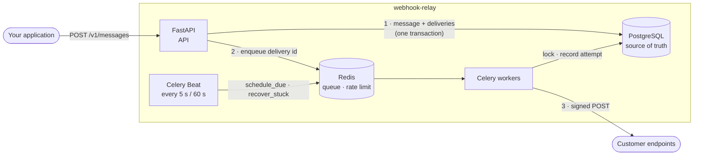
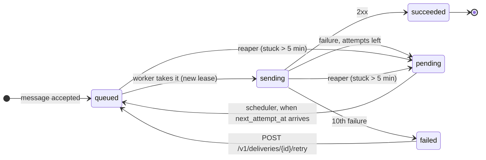

# webhook-relay

[](https://github.com/IrvinSamboy/WebHook_Delivery/actions/workflows/ci.yml)

A reliable webhook delivery service. Your application sends an event once; webhook-relay
signs it, delivers it to every subscribed endpoint, retries with backoff for hours when
receivers fail, and keeps a full record of every attempt.

Backend only: **FastAPI · SQLAlchemy 2 · PostgreSQL · Celery · Redis · Docker Compose**.

```
POST /v1/messages ──► 202 in ~20 ms ──► signed POST to each endpoint, retried for ~4 h if needed
```

## Highlights

- **No lost events.** PostgreSQL is the source of truth; the queue only carries ids. A message
  and its deliveries are written in one transaction before the API answers.
- **Retries that survive restarts.** Exponential backoff with jitter (10 attempts, ~4 h),
  `Retry-After` honoured, scheduled from PostgreSQL with `FOR UPDATE SKIP LOCKED`.
- **Crash- and pause-safe workers.** A reaper rescues deliveries stuck by dead workers, and a
  fencing token stops a paused "zombie" worker from overwriting the outcome.
- **Standard Webhooks signatures**, with zero-downtime secret rotation (two signatures
  during a 24 h grace period).
- **Idempotent message creation** (`Idempotency-Key`), safe under concurrent retries.
- **SSRF protection** at registration *and* before every send (DNS rebinding).
- **Per-application rate limiting** in Redis, failing open if Redis is down.
- **430+ tests**: fast unit tests with fakes and integration tests against real PostgreSQL
  and Redis, all run in CI.

## Architecture



The code follows a layered (ports and adapters) structure:

```
backend/src/relay/
├── domain/          entities, state machine, retry policy, signing — standard library only
├── application/     one use case per operation + the ports (Protocols) they depend on
├── infrastructure/  adapters: SQLAlchemy, httpx2, Celery, Redis, Fernet, DNS guard
├── entrypoints/     FastAPI routers, Celery tasks, CLI
└── container.py     composition root: the only place that wires adapters to ports
```

### Life of a delivery



Each send runs as **two short transactions with the HTTP call outside both**, so a slow
receiver never holds a database connection or a row lock. The reasoning behind this and
every other design choice is in the [decision records](#design-decisions).

## Quickstart

Requirements: Docker with Compose, `make`, `openssl`.

```bash
make up                         # creates .env with a fresh ENCRYPTION_KEY and starts the stack
make migrate                    # applies the database migrations
make create-app name="Acme"     # prints an API key — save it, it is shown only once
export KEY=whr_...              # the key printed above
```

The API listens on `http://localhost:8000` (change it with `API_PORT` in `.env`), with
interactive docs at [`/docs`](http://localhost:8000/docs).

Register an endpoint. In development it points at the bundled test receiver:

```bash
curl -s localhost:8000/v1/endpoints \
  -H "Authorization: Bearer $KEY" -H "Content-Type: application/json" \
  -d '{"url": "http://receiver:9000/", "event_types": ["order.paid"]}'
# → {"id": "…", "secret": "whsec_…", …}   the signing secret is shown only here
```

Start the receiver with that secret (in another terminal) and send an event:

```bash
make receiver secret=whsec_...

curl -s localhost:8000/v1/messages \
  -H "Authorization: Bearer $KEY" -H "Content-Type: application/json" \
  -H "Idempotency-Key: order-1042-paid" \
  -d '{"event_type": "order.paid", "payload": {"order_id": 1042, "amount": 4999}}'
# → 202 {"id": "…"}
```

The receiver prints `✅ firma válida → 204`. Check the delivery and its attempts:

```bash
curl -s localhost:8000/v1/messages/<id> -H "Authorization: Bearer $KEY"
curl -s localhost:8000/v1/messages/<id>/attempts -H "Authorization: Bearer $KEY"
```

To watch retries, run the receiver with `status=500`; to simulate a slow receiver, `delay=2`.

## Delivery guarantees

| Guaranteed | Not guaranteed |
|---|---|
| **At-least-once** delivery: an accepted message is never lost | **Exactly-once**: a receiver may get the same message twice |
| Every request is signed and timestamped | **Ordering** between messages |
| Up to 10 attempts over ~4 h, then `failed` (retryable by hand) | Delivery to endpoints that stay down longer than that |
| A full history of attempts, responses and errors | |

Exactly-once is impossible over HTTP: if the receiver processes a request and the response is
lost, the sender cannot know. So **receivers must deduplicate on `webhook-id`**, which stays
the same across retries.

### Request format

```http
POST /your/endpoint HTTP/1.1
content-type: application/json
webhook-id: 0b9e3c1e-…            # the message id: deduplicate on it
webhook-timestamp: 1764100000     # when this attempt was sent
webhook-signature: v1,K5o…=       # two signatures, space-separated, during a secret rotation

{"type": "order.paid", "timestamp": "2026-11-25T19:14:38.136019Z", "data": {"order_id": 1042, "amount": 4999}}
```

The body wraps your payload in `data`, with the event type and the time the message was
accepted.

### Verifying a signature

Signatures follow [Standard Webhooks](https://www.standardwebhooks.com/), so the official
libraries work. In plain Python:

```python
import base64, hashlib, hmac, time

def verify(secret: str, headers: dict, body: bytes, tolerance: int = 300) -> bool:
    msg_id, ts = headers["webhook-id"], headers["webhook-timestamp"]
    if abs(time.time() - int(ts)) > tolerance:          # reject replays
        return False
    key = base64.b64decode(secret.removeprefix("whsec_"))
    digest = hmac.new(key, f"{msg_id}.{ts}.".encode() + body, hashlib.sha256).digest()
    expected = "v1," + base64.b64encode(digest).decode()
    return any(hmac.compare_digest(expected, sig) for sig in headers["webhook-signature"].split())
```

Sign over the **raw body bytes** as received, not over re-serialised JSON.

## API

All routes except `/health` require `Authorization: Bearer <api key>`.

| Method | Route | Description |
|---|---|---|
| `POST` | `/v1/endpoints` | Register an endpoint (`url`, `event_types`). Returns the secret once. |
| `GET` | `/v1/endpoints` | List endpoints. |
| `GET` | `/v1/endpoints/{id}` | Get one endpoint. |
| `PATCH` | `/v1/endpoints/{id}` | Change `url`, `event_types` or `enabled`. A new URL applies to pending retries. |
| `POST` | `/v1/endpoints/{id}/rotate-secret` | New secret; the old one stays valid for 24 h (`?expire_previous=true` drops it now). |
| `GET` | `/v1/endpoints/{id}/stats` | Last 24 h: deliveries per status and success rate. |
| `POST` | `/v1/messages` | Send an event. Optional `Idempotency-Key`. Rate limited. `202`. |
| `GET` | `/v1/messages` | List, newest first. `limit` (≤100), `cursor`, `event_type`. |
| `GET` | `/v1/messages/{id}` | A message and the state of each delivery. |
| `GET` | `/v1/messages/{id}/attempts` | Every attempt: headers sent, status, body, duration, error. |
| `POST` | `/v1/deliveries/{id}/retry` | Retry a `failed` delivery by hand. `409` if it is not failed. |
| `GET` | `/health` | Liveness check. |

**Idempotency.** Repeating `POST /v1/messages` with the same `Idempotency-Key` and the same
content returns the original message with `Idempotent-Replayed: true`; the same key with
different content returns `422`. Keys do not expire.

**Rate limiting.** `RATE_LIMIT_PER_MINUTE` messages per application per minute. Responses
include `X-RateLimit-Limit`, `X-RateLimit-Remaining` and `X-RateLimit-Reset`; over the limit,
`429` with `Retry-After`.

**Pagination.** Cursor-based on `(created_at, id)`: pass `next_cursor` from one page as
`cursor` for the next; it is `null` on the last page. Pages stay stable while new messages
arrive.

## Configuration

Read from environment variables (`.env` in development; see [`.env.example`](.env.example)).

| Variable | Default | Notes |
|---|---|---|
| `DATABASE_URL` | — required | `postgresql+psycopg://…` |
| `REDIS_URL` | — required | Celery broker and rate-limit counters. |
| `ENCRYPTION_KEY` | — required | Fernet key that encrypts endpoint secrets. **If lost, those secrets cannot be recovered.** `make up` generates one. |
| `BACKOFF_BASE_SECONDS` | `30` | First retry delay, doubled each attempt. `.env.example` uses `2` for development. |
| `ALLOW_PRIVATE_URLS` | `false` | **Keep `false` in production.** `true` only so the dev receiver (`http://receiver:9000`) works. |
| `RATE_LIMIT_PER_MINUTE` | `600` | Per application, on `POST /v1/messages`. |
| `API_PORT` | `8000` | Host port for the API in Docker Compose. |

## Development

```bash
make up                # start postgres, redis, api, worker, beat
make logs              # API logs (worker-logs, beat-logs for the others)
make psql              # a psql shell on the dev database
make migration m="…"   # autogenerate a migration
make format            # ruff: sort imports and format
make lint              # ruff check + format check + mypy
make test              # unit tests
make test-integration  # integration tests against real PostgreSQL and Redis
make check             # everything CI runs
make down
```

### Tests

| Suite | Count | Time | Needs | What it covers |
|---|---|---|---|---|
| Unit — `tests/unit` | ~390 | ~3 s | nothing | Use cases against in-memory fakes of every port, domain rules (state machine, retry policy, signing, SSRF checks), API routes through FastAPI's `TestClient`. |
| Integration — `tests/integration` | ~50 | ~12 s | PostgreSQL, Redis | Repositories and constraints, `SKIP LOCKED` claims, the idempotency race, a zombie worker racing its replacement, migrations from scratch and model/migration drift, the Redis rate limiter. |

Integration tests create a separate database `<POSTGRES_DB>_test`, migrate it from scratch,
truncate tables after each test and drop it at the end; the development database is never
touched. Tests were checked by **sabotage**: break the code a test protects and confirm the
test fails.

**CI** ([`.github/workflows/ci.yml`](.github/workflows/ci.yml)) runs on every push and pull
request: lint and types, unit tests, integration tests with PostgreSQL and Redis service
containers, and a Docker image build.

## Performance

Measured with [Locust](https://locust.io/) (`make load`, `make load-report`). Everything —
Locust, the API (4 uvicorn processes), one Celery worker (4 processes), PostgreSQL, Redis and
the receiver — ran on **one laptop under WSL2 (12 vCPUs, 7.6 GB RAM)**. Treat the numbers as
orders of magnitude, not a benchmark.

| Scenario | API throughput | `POST /v1/messages` p50 / p95 / p99 | Errors | End-to-end p50 / p95 (accepted → delivered) |
|---|---|---|---|---|
| 50 users, fast receiver | 50 req/s | 22 / 130 / 270 ms | 0 | 26 ms / 0.8 s — 2,493 of 2,493 delivered |
| 300 users, fast receiver | **~170 msg/s** (API saturated) | 310 / 720 / 930 ms | 0 | 6.4 s / 12 s — workers deliver ~143/s, so a backlog forms and drains |
| 10 users, receiver takes 2 s | 10 req/s | 23 / 81 / 96 ms | 0 | 53 s / 98 s — workers deliver 2/s (4 processes × 1 per 2 s) |

What this shows:

- **The queue decouples accepting from delivering.** With a receiver that takes 2 s, the API
  answered exactly as fast as with an instant one, while the backlog drained at the speed the
  workers allow. Slow customers do not slow down producers.
- **Nothing was lost under saturation.** At 300 users every accepted message was delivered;
  the cost was latency, not errors.
- **Scaling is horizontal.** Delivery throughput is bounded by worker processes per receiver
  latency; more worker replicas raise it, and `SKIP LOCKED` lets schedulers and workers run
  in parallel safely.

The end-to-end figure is computed in SQL from data the service already stores (message
`created_at` to the end of the successful attempt), so no extra instrumentation was needed.

## Design decisions

Each decision has a short record with context, alternatives and trade-offs in
[`docs/decisions/`](docs/decisions/README.md):

1. [Layered architecture with ports and adapters on a synchronous stack](docs/decisions/0001-layered-architecture-sync-stack.md)
2. [PostgreSQL is the source of truth; the queue only carries ids](docs/decisions/0002-postgres-source-of-truth.md)
3. [Standard Webhooks signatures](docs/decisions/0003-standard-webhooks-signing.md)
4. [Two short transactions with the HTTP call outside both](docs/decisions/0004-two-transactions-around-http.md)
5. [Retries scheduled in PostgreSQL, not with Celery ETAs](docs/decisions/0005-retry-scheduler-in-postgres.md)
6. [Reaper and fencing token](docs/decisions/0006-reaper-and-fencing-token.md)
7. [Retry policy](docs/decisions/0007-retry-policy.md)
8. [Secrets at rest and rotation](docs/decisions/0008-secrets-at-rest-and-rotation.md)
9. [Cursor pagination](docs/decisions/0009-cursor-pagination.md)
10. [SSRF protection](docs/decisions/0010-ssrf-protection.md)
11. [Idempotency keys](docs/decisions/0011-idempotency-keys.md)
12. [Rate limiting](docs/decisions/0012-rate-limiting.md)
13. [Testing strategy](docs/decisions/0013-testing-strategy.md)

## Known limitations and next steps

Deliberately out of scope, or accepted trade-offs:

- **SSRF TOCTOU window.** The destination is checked right before sending, but httpx resolves
  DNS again; a few milliseconds remain for a rebinding attack. Closing it needs IP pinning or
  an egress proxy.
- **Fixed-window rate limit.** A client can burst up to 2× the limit across a minute boundary.
- **No per-endpoint concurrency limit.** A popular event fans out to a receiver as fast as the
  workers go; a slow receiver also occupies worker processes that others could use.
- **No automatic endpoint disabling** after repeated failures, and no endpoint deletion.
- **Long backlogs re-enqueue work.** Deliveries waiting in the queue for over 5 minutes are
  re-enqueued by the reaper; the duplicate tasks are no-ops but add queue traffic.
- **Observability.** Logs only: no metrics (Prometheus) or traces (OpenTelemetry) yet.
- **Retention.** Messages and attempts are kept forever; a retention job would also be the
  natural expiry for idempotency keys.
- **Single-tenant operations.** Applications are created with a CLI; there is no admin API.
